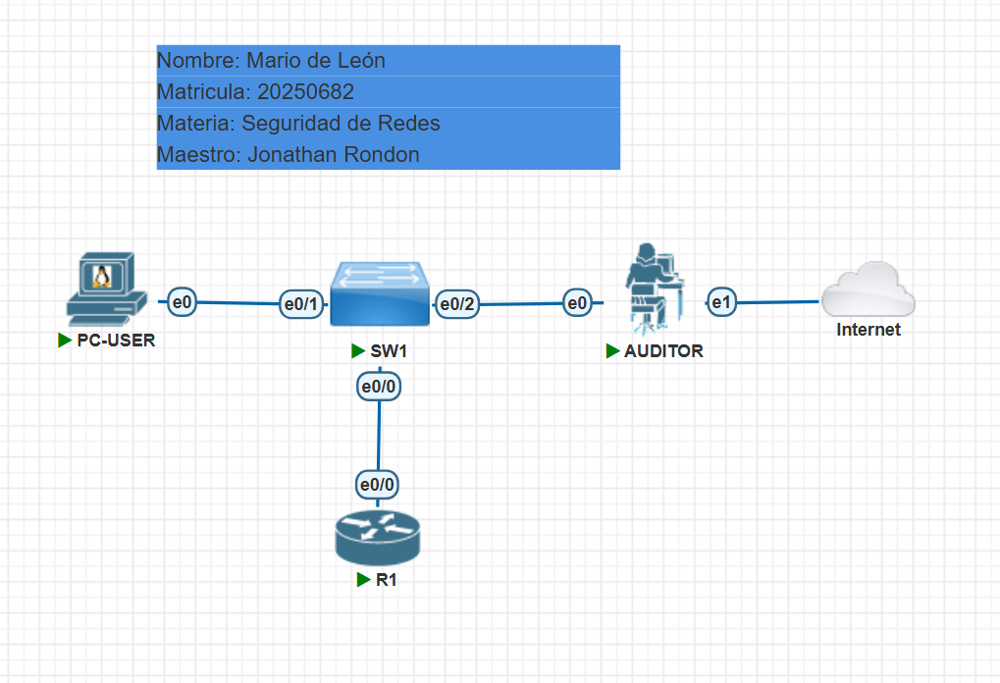
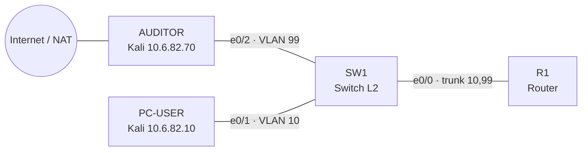
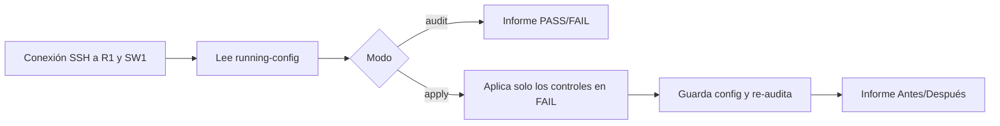

# Hardening CIS en Cisco IOS (PNETLab)

[](https://youtu.be/3RDcoVWvwRA)

**Video demostrativo:** https://youtu.be/3RDcoVWvwRA

[](https://youtu.be/3RDcoVWvwRA)
[](docs/informe.md)
[](scripts/hardening_cis.py)
[](running-configs/)
[](reports/)
[](docs/images/)

**Ir directo a:**
[Topología](docs/informe.md#2-topología) ·
[Controles CIS](docs/informe.md#4-recomendaciones-aplicadas-y-por-qué) ·
[Antes](docs/informe.md#5-evidencia-antes-del-hardening) ·
[Apply](docs/informe.md#6-aplicación-del-hardening) ·
[Después](docs/informe.md#7-pruebas-después-del-hardening) ·
[Auditoría final](docs/informe.md#8-auditoría-final) ·
[Limitaciones](docs/informe.md#10-limitaciones)

| | |
|---|---|
| **Autor** | Mario de León |
| **Matrícula** | 20250682 |
| **Materia** | Seguridad de Redes |
| **Maestro** | Jonathan Rondon |

## Propósito

Demostrar cómo se aplica *hardening* a un router y a un switch Cisco IOS siguiendo recomendaciones del **CIS Benchmark de Cisco IOS**, y comprobar que funciona. El laboratorio incluye:

- Una topología en PNETLab con un router (R1) y un switch (SW1).
- Un script en Python (`scripts/hardening_cis.py`) que audita 15 controles CIS por SSH, con dos modos:
  - `--mode audit`: genera un informe sin modificar nada.
  - `--mode apply`: aplica las reglas que fallan, guarda la configuración y genera un informe posterior (Antes/Después).
- Pruebas de que la superficie de ataque se reduce (nmap, Telnet, SSH, `show`) sin romper la conectividad.

Resultado: de **1/15** (R1) y **0/15** (SW1) controles cumplidos a **15/15** en ambos equipos.

## Topología



| Nodo | Función | IP |
|------|---------|----|
| R1 | Router, gateway de las VLAN (router-on-a-stick) | 10.6.82.1 (VLAN 10) · 10.6.82.65 (VLAN 99) |
| SW1 | Switch con VLAN 10 (USERS) y VLAN 99 (MGMT) | 10.6.82.66 |
| PC-USER | Cliente de la VLAN de usuarios | 10.6.82.10/26 |
| AUDITOR | Ejecuta el script y nmap | 10.6.82.70/26 |
| NAT | Internet solo para instalar paquetes | DHCP |

El direccionamiento (10.6.82.0/24) se deriva de los últimos cuatro dígitos de la matrícula (0682).

## Flujo del script



## Contenido

| Ruta | Descripción |
|------|-------------|
| [`docs/informe.md`](docs/informe.md) | Informe completo: controles, justificación y evidencias |
| `docs/images/` | Capturas de pantalla |
| `scripts/hardening_cis.py` | Script de auditoría y hardening |
| `running-configs/` | Configuraciones de R1 y SW1: antes, después y auditoría final |
| `reports/` | Informes generados por el script (`.txt` y `.json`) |

## Uso del script

```bash
pip3 install netmiko==3.4.0
python3 scripts/hardening_cis.py --mode audit   # solo informe
python3 scripts/hardening_cis.py --mode apply   # aplica y genera informe posterior
```

## Nota sobre credenciales

Es un laboratorio. `Admin123` y `enable password cisco` son credenciales de práctica que solo existen en la topología de PNETLab; las configuraciones de "antes" las muestran a propósito como parte de la configuración vulnerable.
