# Informe: Hardening CIS en Cisco IOS

**Autor:** Mario de León · **Matrícula:** 20250682 · **Materia:** Seguridad de Redes · **Maestro:** Jonathan Rondon

Video demostrativo: https://youtu.be/3RDcoVWvwRA

## 1. Objetivo

Aplicar recomendaciones del CIS Benchmark de Cisco IOS a un router y un switch, medir el cumplimiento con un script propio y demostrar con pruebas que la superficie de ataque se reduce sin afectar el servicio.

## 2. Topología

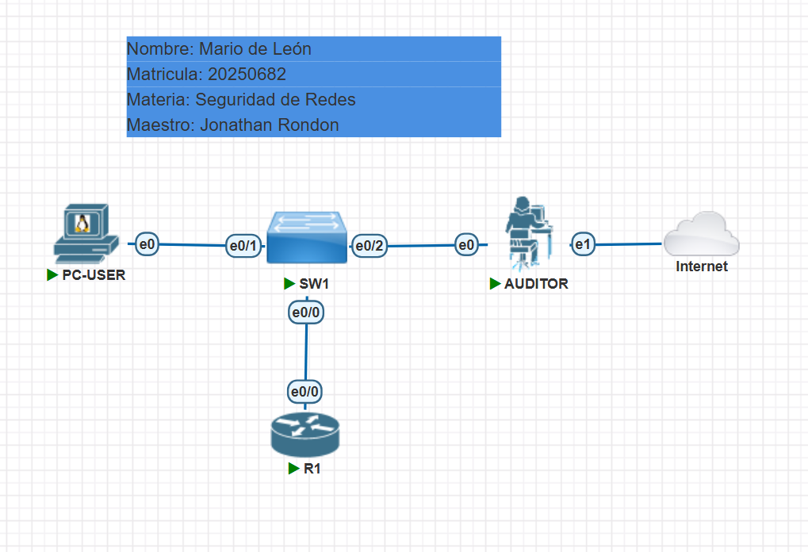

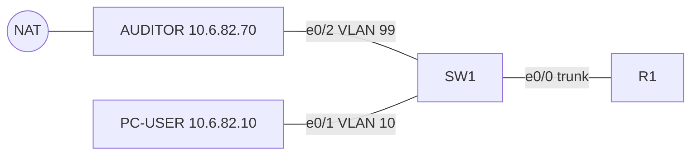

| VLAN | Red | Gateway |
|------|-----|---------|
| 10 USERS | 10.6.82.0/26 | 10.6.82.1 |
| 99 MGMT | 10.6.82.64/26 | 10.6.82.65 |

Equipos: R1 (Cisco IOL L3), SW1 (Cisco IOL L2), PC-USER y AUDITOR (Kali Linux) y una nube NAT.

Configuración base de R1 y SW1:

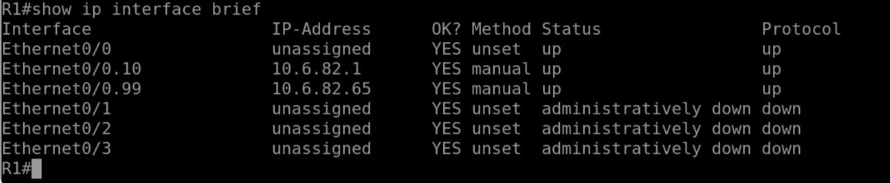
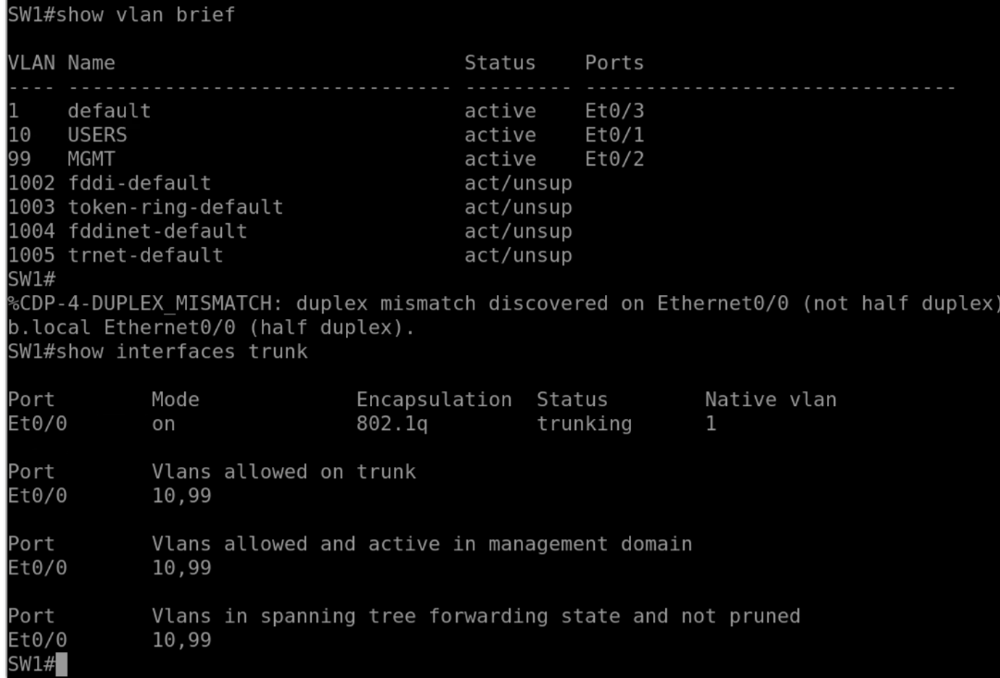

Conectividad previa al hardening:

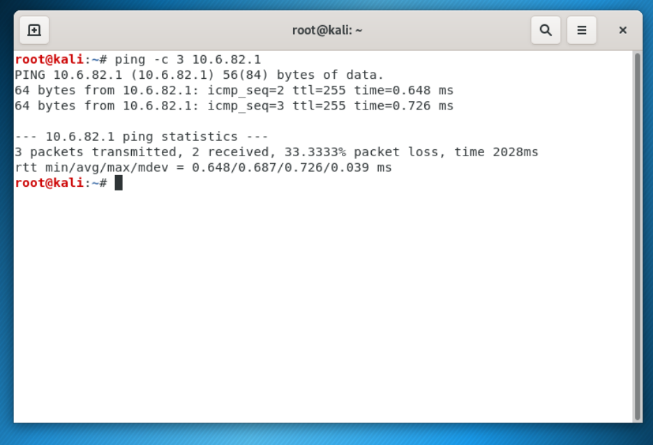
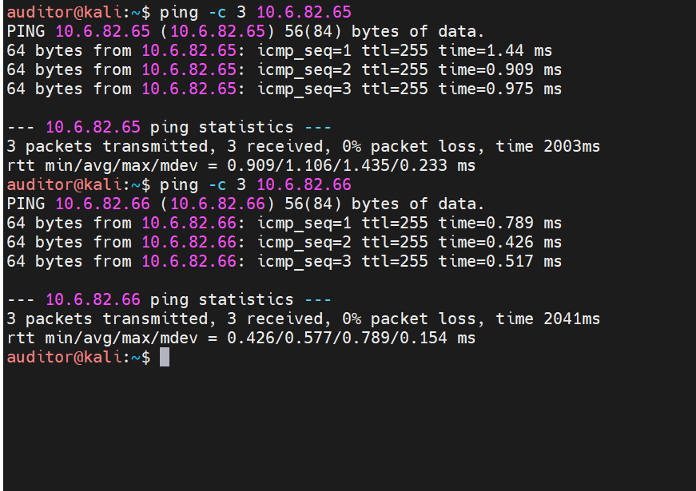
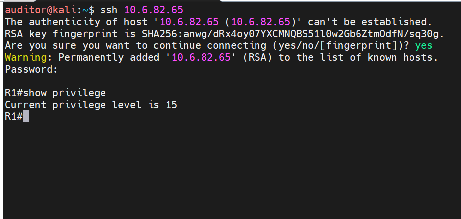

## 3. Herramienta de análisis

La herramienta es el script `scripts/hardening_cis.py`. Se conecta por SSH (Netmiko) a R1 y SW1, lee la `running-config` y evalúa 15 controles basados en el CIS Benchmark de Cisco IOS. Cada control termina en PASS o FAIL. No se usó CIS-CAT Pro porque requiere membresía de CIS.

| Modo | Comando | Efecto |
|------|---------|--------|
| Informe | `python3 hardening_cis.py --mode audit` | Solo lee y genera el informe; no cambia nada |
| Aplicar | `python3 hardening_cis.py --mode apply` | Corrige los controles en FAIL, guarda y genera el informe posterior |

## 4. Recomendaciones aplicadas y por qué

| ID | Recomendación | Por qué se aplicó |
|----|---------------|-------------------|
| C01 | `service password-encryption` | Evita contraseñas legibles en la configuración |
| C02 | `enable secret` y quitar `enable password` | El secret se guarda con hash; el password va en claro |
| C03 | `no ip http server` / `no ip http secure-server` | Reduce la superficie de ataque (administración web innecesaria) |
| C04 | `no cdp run` | CDP revela modelo, versión de IOS e IPs a quien escuche |
| C05 | `ip ssh version 2` | SSHv1 tiene fallos criptográficos conocidos |
| C06 | VTY solo SSH (`transport input ssh`) | Telnet envía las credenciales en texto plano |
| C07 | `exec-timeout 5 0` en VTY | Cierra sesiones administrativas abandonadas |
| C08 | `banner login` | Aviso legal de acceso restringido |
| C09 | `no ip source-route` | Evita el enrutamiento forzado por el origen |
| C10 | `logging buffered` | Deja registro de eventos para auditoría |
| C11 | `login block-for 120 attempts 3 within 60` | Frena ataques de fuerza bruta |
| C12 | `aaa new-model` con autenticación y autorización exec locales | Base de autenticación centralizada; sin la autorización, IOS ignora el `privilege 15` del usuario |
| C13 | `no ip proxy-arp` en interfaces con IP | Evita que el router responda ARP por otras redes |
| C14 | `switchport nonegotiate` en trunks | Desactiva DTP y evita trunks no autorizados |
| C15 | `service timestamps log datetime msec` | Permite correlacionar eventos |

En R1, C14 sale PASS desde el inicio porque el router no tiene puertos trunk de switch; el control aplica realmente a SW1.

## 5. Evidencia antes del hardening

Informe inicial (modo `audit`): R1 cumple 1/15 y SW1 0/15.

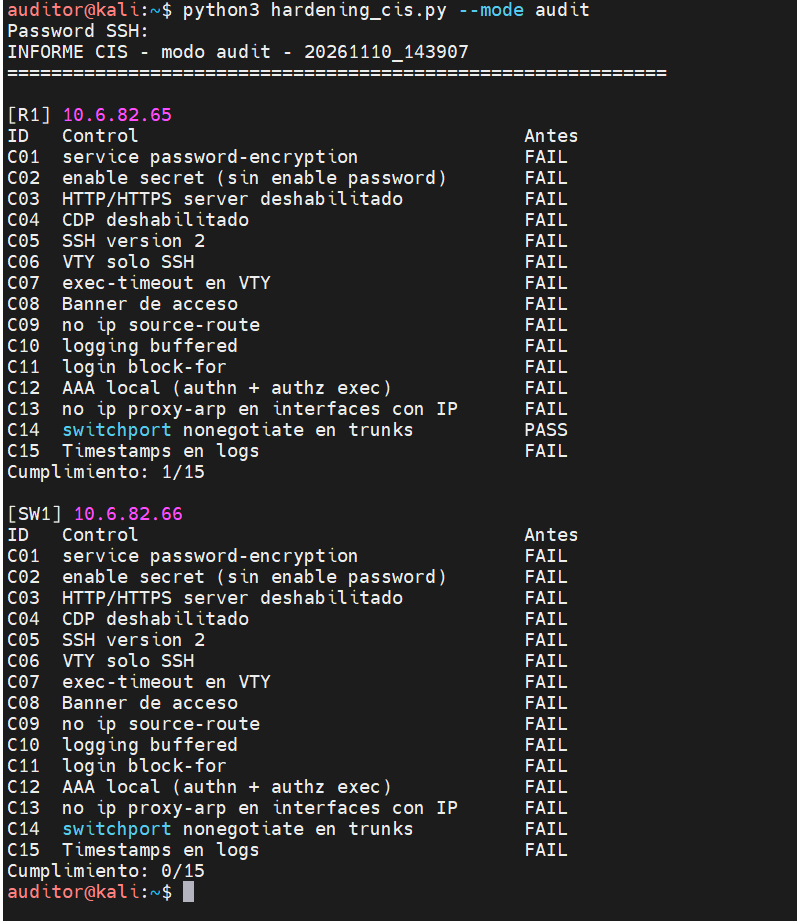

Puertos abiertos 22, 23 y 80 en ambos equipos:

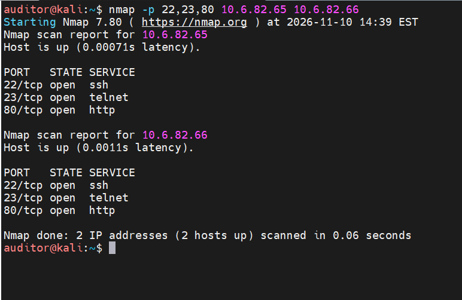

Telnet responde y pide credenciales en texto plano:

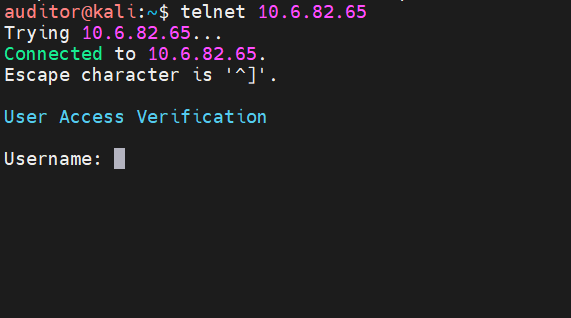

El puerto 23 también es alcanzable desde la VLAN de usuarios (PC-USER):

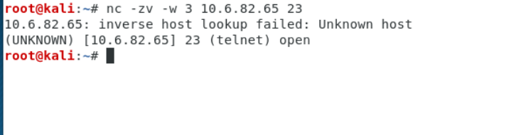

Configuración vulnerable en cada equipo:

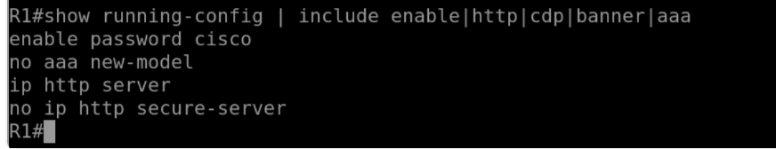
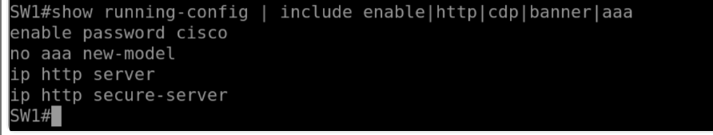

## 6. Aplicación del hardening

Ejecución de `--mode apply`: todos los controles en FAIL pasan a PASS y ambos equipos llegan a 15/15.

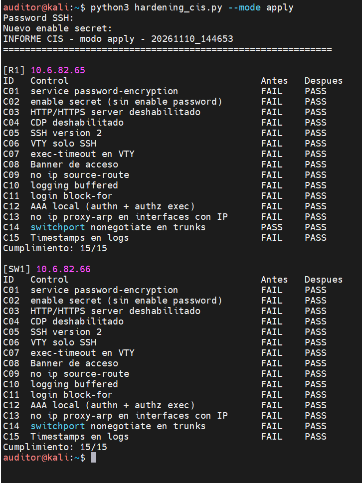

## 7. Pruebas después del hardening

| Control | Prueba | Antes | Después | Evidencia |
|---------|--------|-------|---------|-----------|
| C03, C06 | `nmap -p 22,23,80` desde AUDITOR | 22, 23 y 80 abiertos | Solo 22 abierto | [12](images/12-nmap-despues.png) |
| C06 | `telnet 10.6.82.65` | Pide usuario | `Connection refused` | [13](images/13-telnet-despues.png) |
| C08 | `ssh 10.6.82.65` | Sin banner | Banner de acceso y entrada en `R1#` | [14](images/14-ssh-despues.png) |
| C06 | `nc -zv 10.6.82.65 23` desde PC-USER | Abierto | Cerrado | [15](images/15-nc-despues.png) |
| Disponibilidad | `ping 10.6.82.1` desde PC-USER | Responde | Sigue respondiendo | [16](images/16-ping-despues.png) |

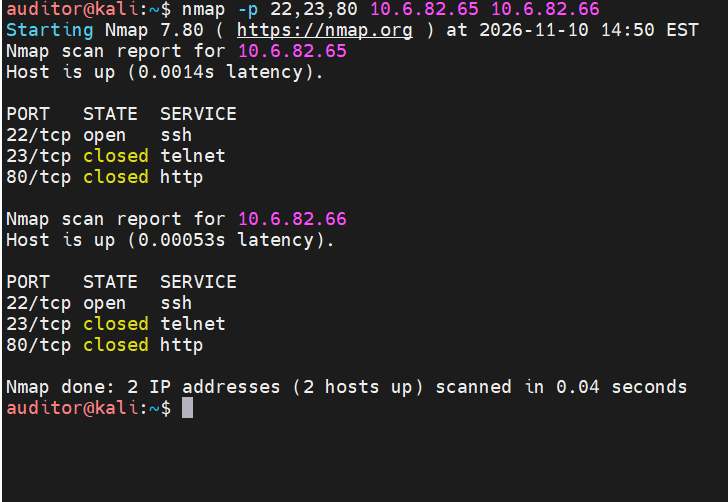
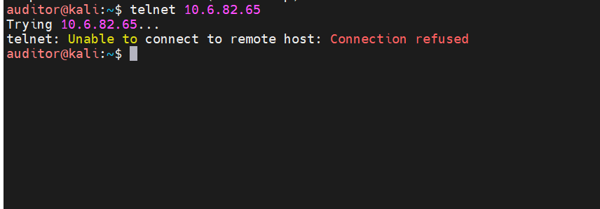
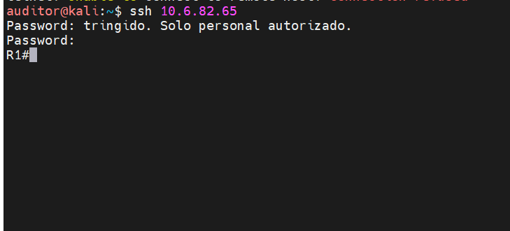
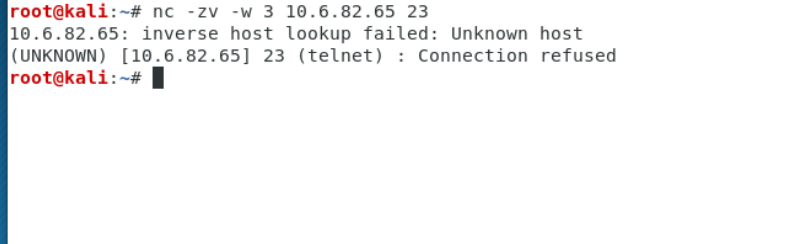
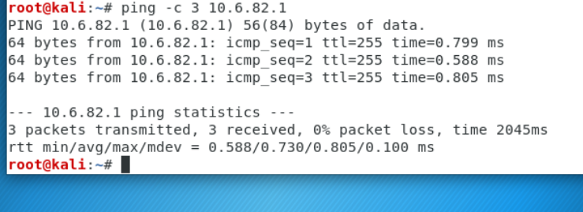

Verificación dentro de los equipos (`show ip ssh`, `show cdp`, `show running-config`, `show logging`):

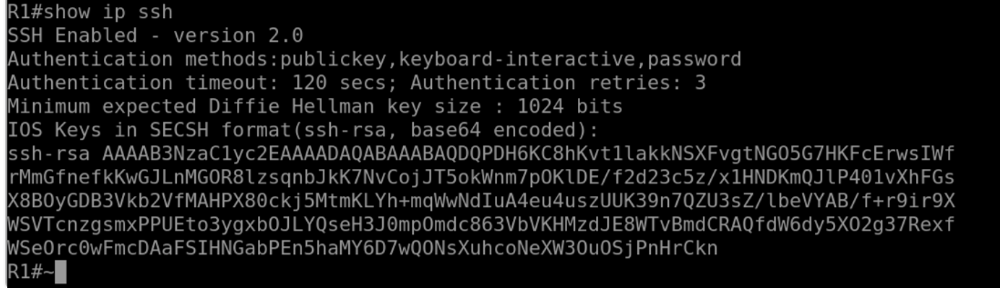
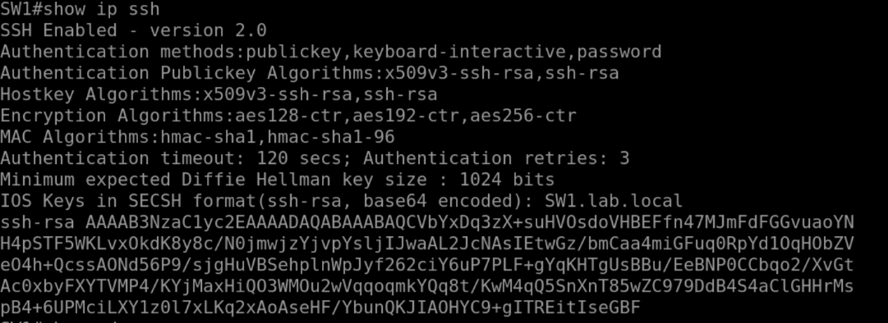
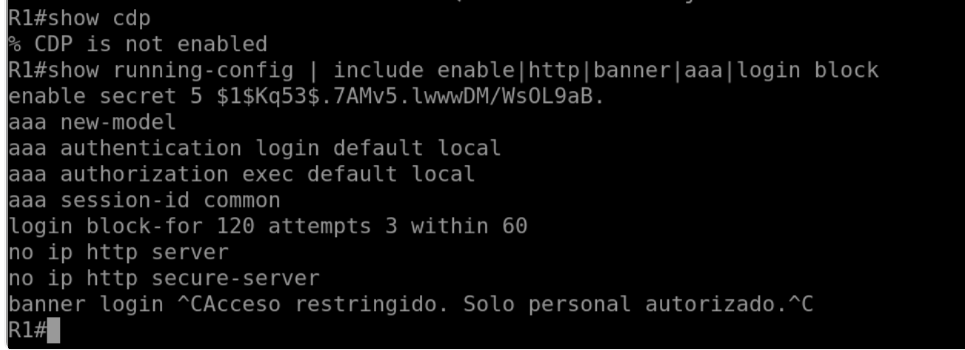
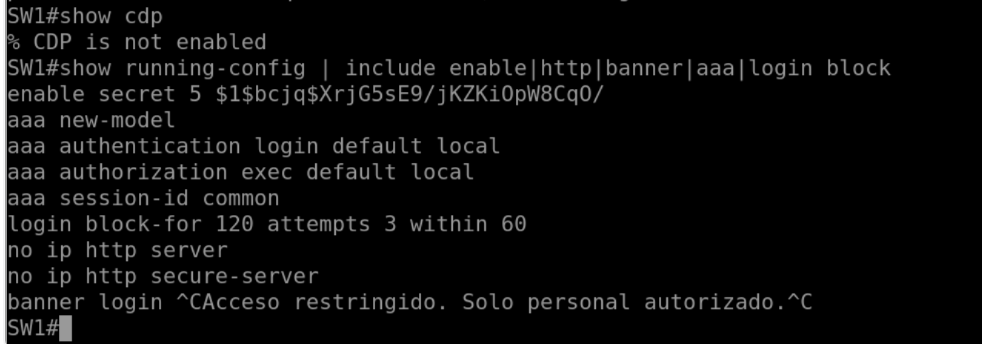
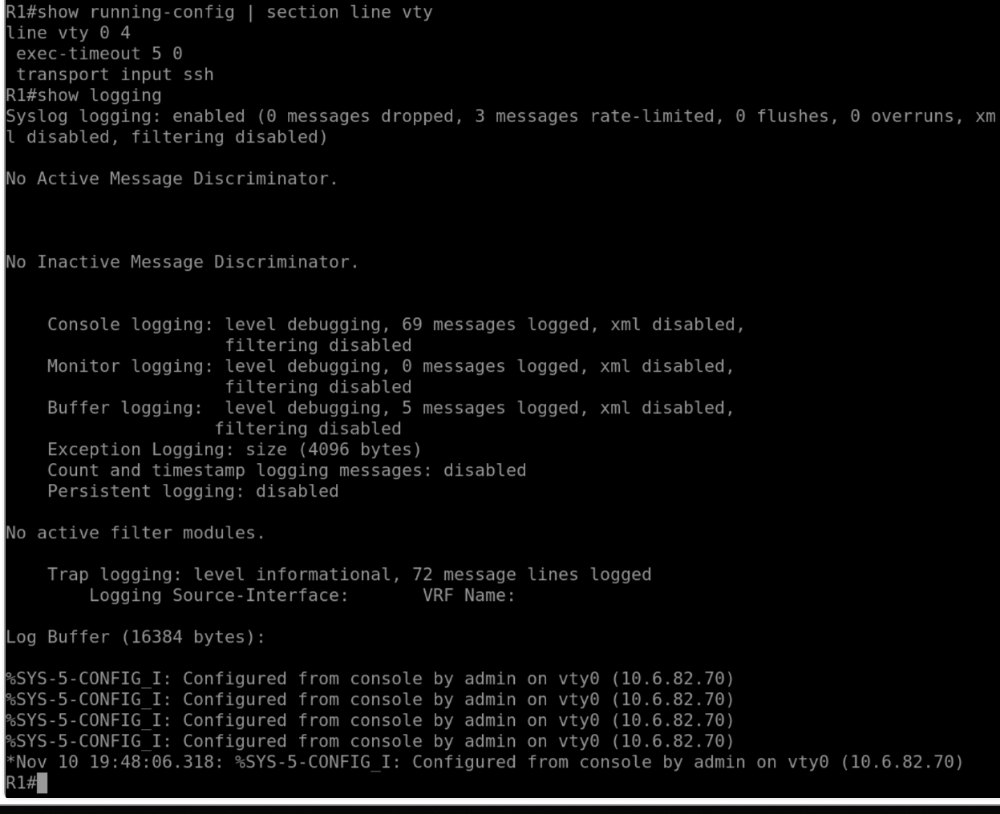
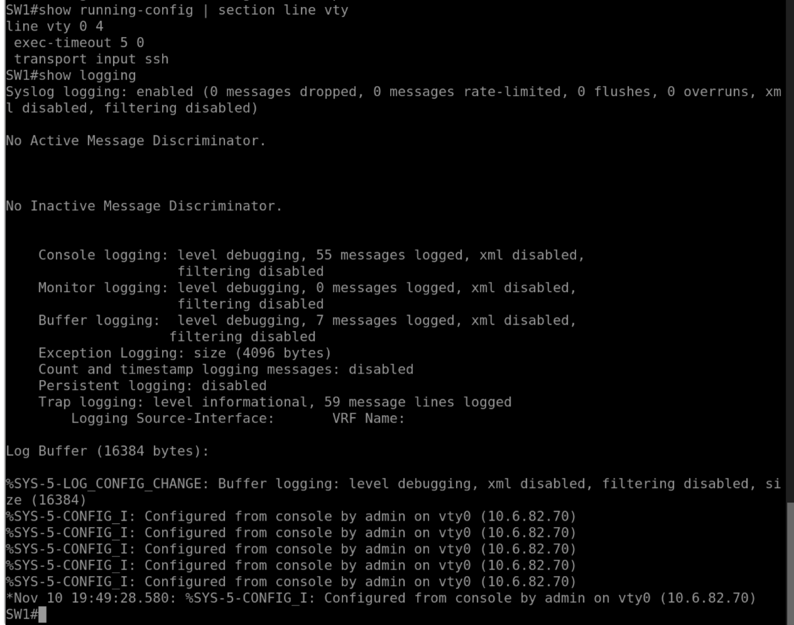

### Protección contra fuerza bruta (C11)

Tras tres intentos fallidos en menos de 60 segundos, R1 entra en Quiet-Mode y rechaza todos los logins durante 120 segundos.

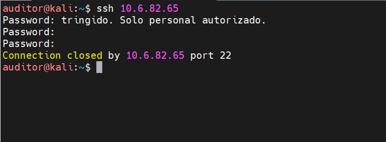
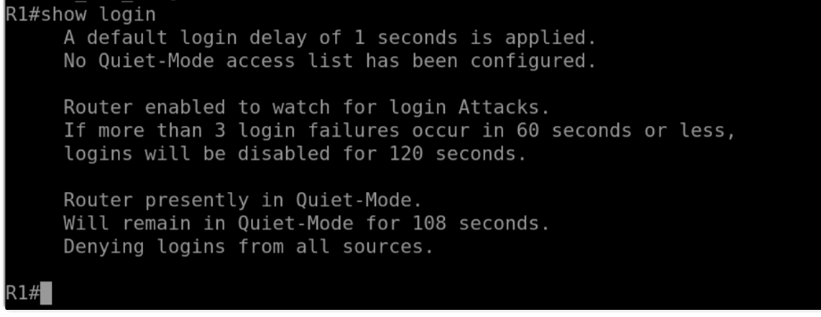

## 8. Auditoría final

Segunda ejecución de `--mode audit` tras el hardening: 15/15 en R1 y en SW1.

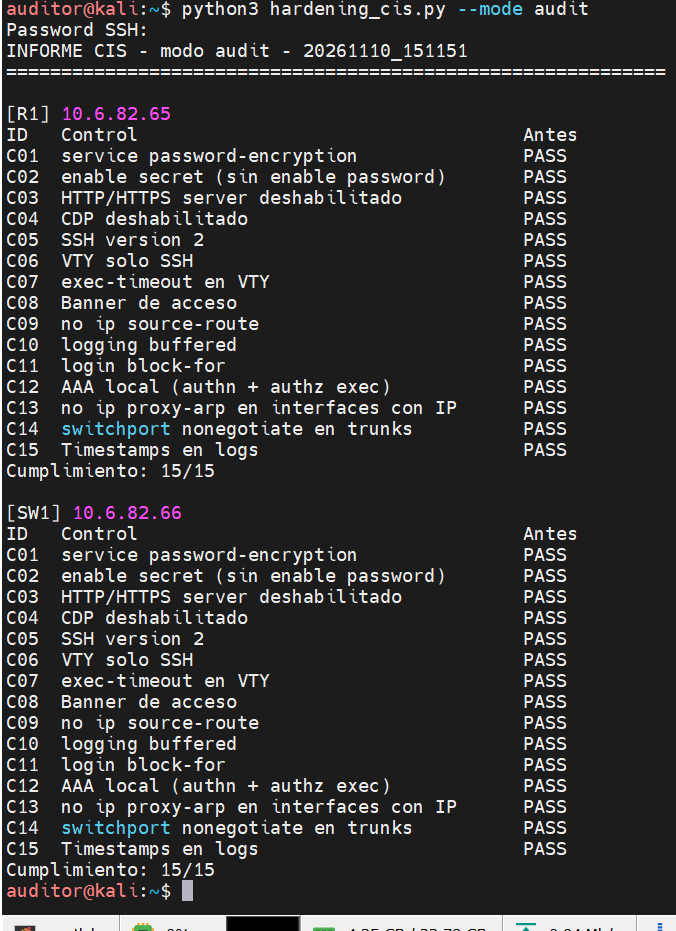

## 9. Archivos de soporte

- Script: [`scripts/hardening_cis.py`](../scripts/hardening_cis.py)
- Configuraciones: [`running-configs/`](../running-configs/) (`R1_antes`, `R1_despues`, `R1_audit_final`, y lo mismo para SW1)
- Informes del script: [`reports/`](../reports/)

## 10. Limitaciones

- Las líneas VTY de la imagen IOL son solo `0 4`.
- La imagen de switch `i86bi_linux_l2-advipservicesk9` no incluye servidor SSH, por lo que se usó `i86bi_Linux-L2-Adventerprisek9-ms.SSA.high_iron_20190423` para SW1.
- Las IOL ofrecen algoritmos SSH antiguos (CBC, DH group14/group1); el cliente de AUDITOR se configuró con listas exactas en `~/.ssh/config`.
- El script no audita puertos sin uso del switch.
- `reports/` contiene también una corrida de `audit` adicional (`151044`) hecha durante las pruebas.
- Las credenciales mostradas son de laboratorio.
